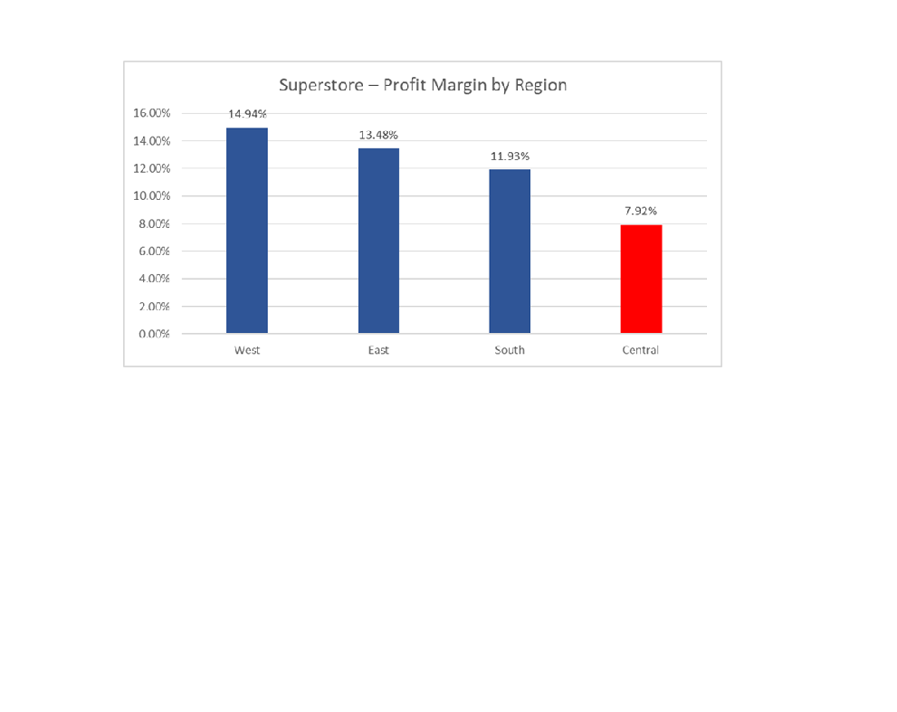

# Superstore Sales and Profitability Analysis

## Project Overview

This project analyses Superstore sales data using Microsoft Excel to evaluate business performance, identify profitability trends and develop data-driven recommendations.

The analysis focuses on sales, profit margins, regional performance, product categories and the relationship between discounting and profitability.

## Project Objectives

- Analyse overall sales and profitability.
- Compare performance across regions and product categories.
- Examine sales and profit trends between 2014 and 2017.
- Identify underperforming areas of the business.
- Investigate the relationship between discounts and profitability.
- Provide actionable business recommendations.

## Tools and Techniques

**Tools:** Microsoft Excel

**Techniques:**
- Data cleaning and validation
- PivotTables
- Excel formulas and calculations
- Key Performance Indicators (KPIs)
- Profit margin analysis
- Data visualisation
- Business reporting and interpretation

## Key Performance Indicators

| KPI | Result |
|---|---:|
| Total Sales | £2,297,200.86 |
| Total Profit | £286,397.02 |
| Overall Profit Margin | 12.47% |

Profit Margin = (Profit / Sales) × 100

## Regional Profitability Analysis

| Region | Sales (£) | Profit (£) | Profit Margin |
|---|---:|---:|---:|
| West | 725,457.82 | 108,418.45 | 14.94% |
| East | 678,781.24 | 91,522.78 | 13.48% |
| South | 391,721.91 | 46,749.43 | 11.93% |
| Central | 501,239.89 | 39,706.36 | 7.92% |

### Profit Margin by Region – Chart

### Key Findings

- West achieved the highest profit margin at 14.94%.
- Central recorded the lowest profit margin at 7.92%.
- Central's margin was 4.55 percentage points below the overall business margin.
- The difference between West and Central was 7.02 percentage points.

## Product Category Analysis

| Category | Sales (£) | Profit (£) | Profit Margin |
|---|---:|---:|---:|
| Technology | 836,154.03 | 145,454.95 | 17.40% |
| Office Supplies | 719,047.03 | 122,490.80 | 17.04% |
| Furniture | 741,999.80 | 18,451.27 | 2.49% |

Technology achieved the highest sales, profit and profit margin, while Furniture showed substantially weaker profitability.

## Investigation: Central Region Furniture

Further analysis identified losses in several Furniture subcategories within the Central region.

| Subcategory | Profit (£) |
|---|---:|
| Bookcases | -1,997.90 |
| Chairs | 6,592.72 |
| Furnishings | -3,906.22 |
| Tables | -3,559.65 |

Chairs was the only profitable Furniture subcategory in Central.

Higher average discounts were observed in several loss-making subcategories, particularly Furnishings.

**Limitation:** The observed association between discounting and lower profitability does not establish that discounts caused the losses.

## Business Recommendations

1. Review discounting practices in the Central region, particularly for Furnishings and Tables.
2. Investigate the underlying reasons for Furniture's low profitability.
3. Monitor regional and category-level profit margins alongside sales.
4. Use regular KPI reporting to identify emerging performance issues.
5. Evaluate the impact of any pricing or discount changes before making wider business decisions.

## Project Files

- `Superstore_Sales_Analysis.xlsx` – Excel workbook containing the dataset, analysis, PivotTables, KPI calculations, charts and findings.

## Conclusion

The analysis demonstrates that strong sales do not always translate into strong profitability. Although the Superstore business achieved an overall profit margin of 12.47%, significant differences existed across regions and product categories.

The findings highlight the importance of analysing profit margins, discounting and product performance to support informed business decisions.

## Skills Demonstrated

Data Cleaning | Microsoft Excel | PivotTables | KPI Reporting | Data Visualisation | Profitability Analysis | Business Insights | Analytical Problem-Solving
